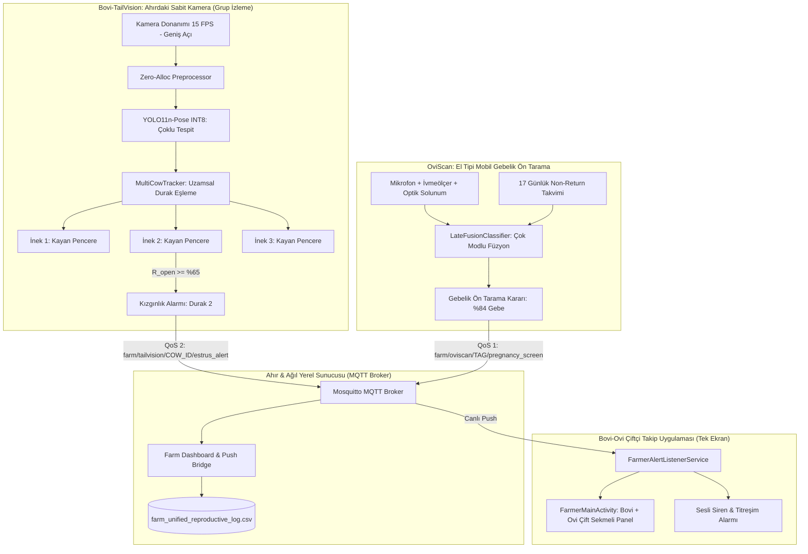

# BOVI-TAILVISION: SİSTEM MİMARİSİ VE TEKNİK TASARIM DOKÜMANI

---

### 1. GENEL MİMARİ VE ÇOKLU İNEK (GRUP) TAKİBİ

Bovi-TailVision, tek bir eski model Android telefonun geniş açılı kamerasıyla ahırdaki bir grup ineği (3-6 durak / yemlik kilit sırası) aynı anda izleyebilir. Derin öğrenme çıkarımı (`YOLO11n-pose INT8`) kare başına **tek bir geçişte (Single Inference Pass)** tüm ineklerin iskeletlerini tespit eder; ardından uzamsal durak eşleme motoru (`MultiCowTracker`) her hayvanı kendi durağına zimmetler.

Ayrıca sistem, **OviScan (Küçükbaş Gebelik Ön Tarama ve Karar Destek)** sistemi ile tam entegre çalışarak çiftlikteki hem büyükbaş (sığır kızgınlık & tohumlama) hem de küçükbaş (koyun gebelik ön tarama) süreçlerini tek bir IoT broker ve çiftçi mobil uygulamasında birleştirir.

---

### 2. MATEMATİKSEL KİNEMATİK VE FİLTRELEME PRENSİPLERİ

#### 2.1. Vektörel Açı Hesabı
* **Kuyruk Vektörü:** $\vec{V}_{\text{tail}} = (x_{\text{mid}} - x_{\text{base}}, y_{\text{mid}} - y_{\text{base}})$
* **Referans Vektörü:** $\vec{V}_{\text{ref}} = (x_{\text{base}} - x_{\text{spine}}, y_{\text{base}} - y_{\text{spine}})$
* **Sapma Açısı ($\theta$):**
  $$\theta = \arccos\left(\frac{\vec{V}_{\text{tail}} \cdot \vec{V}_{\text{ref}}}{\|\vec{V}_{\text{tail}}\| \|\vec{V}_{\text{ref}}\|}\right) \times \frac{180^\circ}{\pi}$$
* Sağa/Sola yön tayini 2B çapraz çarpım (Cross Product Z) işareti ile belirlenir:
  $$\text{Cross}_z = V_{\text{ref}, x} \cdot V_{\text{tail}, y} - V_{\text{ref}, y} \cdot V_{\text{tail}, x}$$

#### 2.2. Gürültü Filtreleme Durum Makinesi (State Machine)
* **Dışkılama / İdrar:** Kuyruğun kökten dikleştiği ($y_{\text{base}} - y_{\text{mid}} > 25\text{ px}$) ve yatay sapmanın düşük olduğu ($|\theta| < 15^\circ$) durumlarda tetiklenir. $15$ saniyeden kısa süren bu durumlar kızgınlık sayacına dahil edilmez.
* **Sinek Savurma:** Açığa çıkma süresi $< 0.3$ saniye olan mikro titreşimler filtrelenir; yalnızca $\ge 1.5$ saniye boyunca kalıcı olan vulva açığa çıkışları geçerli kabul edilir.

---

### 3. BELLEK VE TERMAL YÖNETİM (ZERO-ALLOCATION)

Eski Snapdragon/Exynos yongalarında Garbage Collection (GC) gecikmelerini ve termal aşırı ısınmayı önlemek amacıyla:
1. `ByteBuffer.allocateDirect(1 * 320 * 320 * 3)` tek seferlik başlatılır ve her karede `rewind()` ile yeniden yazılır.
2. Kamera çözünürlüğü $320 \times 320$ seviyesine sabitlenir.
3. Ekran parlaklığı `0.0f` yapılarak OLED/LCD panellerin gereksiz güç harcaması ve ısı üretimi engellenir.
4. `ProcessCameraProvider` doğrudan `LifecycleService` arka plan servisine bağlanarak Activity kapanmalarında bile kamera akışının kesintisiz sürmesi sağlanır.
