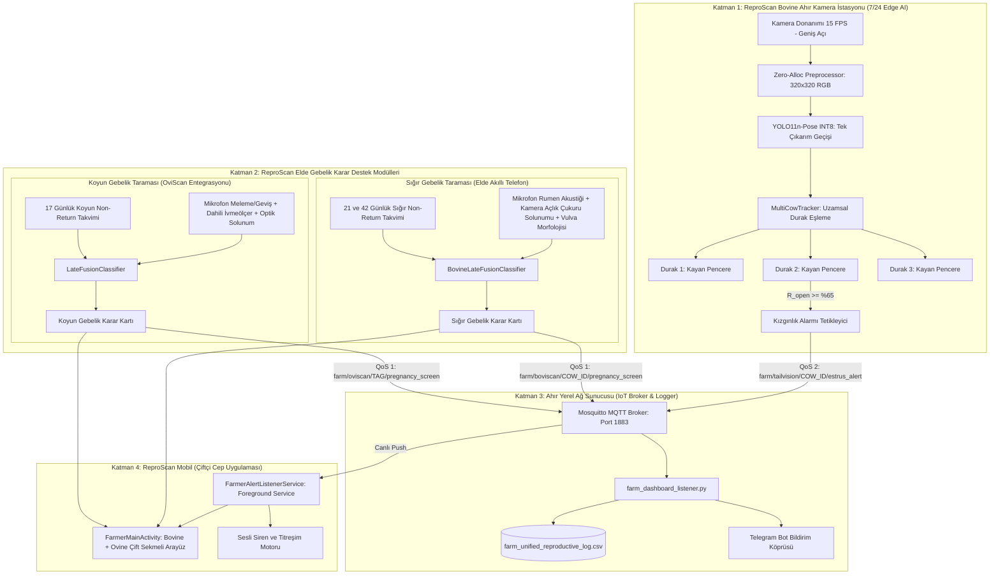

# REPROSCAN: SİSTEM MİMARİSİ VE TEKNİK TASARIM DOKÜMANI
## ÇOK KATMANLI UÇ BİRİM YAPAY ZEKA, ÇOK MODLU KARAR DESTEK VE IoT AĞ PROTOKOLÜ

**Sürüm:** 2.0.0 (Unified Multi-Species Architecture)  
**Tarih:** Kasım 2026

---

### 1. BÜTÜNCÜL SİSTEM MİMARİSİ

ReproScan; ahır ortamında 7/24 çalışan uç birim bilgisayarlı görü istasyonları, çiftçinin cebindeki el tipi çok modlu gebelik tarayıcıları, ahır yerel IoT sunucusu ve bildirim sistemlerinden oluşan çok katmanlı bir mimariye sahiptir.



---

### 2. UÇ BİRİM BİLGİSAYARLI GÖRÜ VE ÇOKLU NESNE TAKİBİ (MOT)

#### 2.1. Tek Çıkarım Geçişi (Single Inference Pass)
Geleneksel nesne takip yaklaşımları (Önce nesne tespiti, ardından her nesne için ayrı iskelet modeli çalıştırma - Top-down), eski akıllı telefon işlemcilerini aşırı ısıtıp kare hızını 2-3 FPS'e düşürmektedir. ReproScan Bovine, **Bottom-up / Single-pass YOLO11n-pose INT8** mimarisi kullanır:
* Görüş alanındaki tüm hayvanların 4 temel anatomik referans noktası ($P_{\text{spine}}, P_{\text{tailbase}}, P_{\text{tailmid}}, P_{\text{vulva}}$) tek bir TFLite çıkarımında hesaplanır.
* Çıkarım süresi Snapdragon 660 / Exynos 7904 sınıfı cihazlarda kare başına **~65 ms** sürmekte ve kesintisiz 15 FPS sağlanmaktadır.

#### 2.2. Uzamsal Durak Yuvalama (Spatial Stall Slotting)
Her hayvan kendi bağlı durağında durduğu için karmaşık optik akış (optical flow) veya Kalman filtreli Macar Algoritması (Hungarian Matching) yerine deterministik **Uzamsal Durak Yuvalama** kullanılır:
1. Ekran genişliği $W$, durak sayısına $M$ bölünerek $\text{Slot}_j = [j \frac{W}{M}, (j+1) \frac{W}{M}]$ sınırları çizilir.
2. Tespit edilen ineğin pelvis merkezi $x_c = \frac{x_{\text{base}} + x_{\text{vulva}}}{2}$ hangi durağın sınırına düşerse, hayvan o durağa zimmetlenir:
   $$\text{Stall}(i) = \left\lfloor \frac{x_c^i \cdot M}{W} \right\rfloor$$
3. Her durak için bağımsız 5 dakikalık kayan pencere ($R_{\text{open}}^j$) ve gürültü durum makinesi işletilir.

#### 2.3. Vektörel Açı ve Gürültü Filtreleme Matematiği
* **Kuyruk Sapma Açısı ($\theta$):**
  $$\vec{V}_{\text{ref}} = (x_0 - x_s, y_0 - y_s), \quad \vec{V}_{\text{tail}} = (x_1 - x_0, y_1 - y_0)$$
  $$\theta = \arccos\left(\frac{\vec{V}_{\text{tail}} \cdot \vec{V}_{\text{ref}}}{\|\vec{V}_{\text{tail}}\| \|\vec{V}_{\text{ref}}\|}\right) \times \frac{180^\circ}{\pi}$$
* **Dışkılama Filtresi:** Dikey kalkış ($y_0 - y_1 > 25\text{ px}$) ve düşük yatay sapma ($|\theta| < 15^\circ$) tespit edildiğinde kızgınlık sayacı kilitlenir.
* **Sinek Savurma Filtresi:** Süresi $< 1.5$ saniye süren anlık salınımlar filtrelenir; yalnızca stabil açığa çıkışlar kaydedilir.

---

### 3. ÇOK MODLU GEÇ FÜZYON (LATE FUSION) MOTORLARI

#### 3.1. Sığır Gebelik Füzyon Modeli (`BovineLateFusionClassifier`)
$$P_{\text{gebe}}^{\text{bovi}} = 0.30 S_{\text{cycle}} + 0.25 S_{\text{rumin}} + 0.15 S_{\text{resp}} + 0.20 S_{\text{vulva}} + 0.10 S_{\text{motion}}$$

| Bileşen | Ölçüm Donanımı | Normal / Gebe Aralığı | Östrus / Boş Göstergesi |
| :--- | :--- | :--- | :--- |
| **$S_{\text{cycle}}$** | Tohumlama Takvimi | 21-60 gün kızgınlık yok ($S=0.88-0.94$) | Kızgınlık görüldü ($S=0.10$) |
| **$S_{\text{rumin}}$** | Dahili Mikrofon | 45-62 çiğneme/dk, ritmik bolus ($S=0.88$) | Böğürme veya $<35$ çiğneme ($S=0.20-0.32$) |
| **$S_{\text{resp}}$** | Kamera (Açlık Çukuru) | 16-26 BPM sakin istirahat ($S=0.85$) | $>36$ BPM ajitasyon ($S=0.35$) |
| **$S_{\text{vulva}}$** | Kamera (Kaudal Pelvis)| Kuru, kapalı, soluk pembe ($S=0.90$) | Ödemli, gevşek, mukuslu ($S=0.20$) |
| **$S_{\text{motion}}$**| Dahili İvmeölçer | Sakin duruş, yüksek yatma ($S=0.85$) | Ayakta ajitasyon ($S=0.25$) |

#### 3.2. Koyun Gebelik Füzyon Modeli (`LateFusionClassifier`)
$$P_{\text{gebe}}^{\text{ovi}} = 0.45 S_{\text{audio}} + 0.40 S_{\text{motion}} + 0.15 S_{\text{camera}} + \text{Bias}_{\text{cycle}}$$
* 17 ve 34 günlük non-return periyotları.
* 44.1 kHz mikrofon spektrumu (geviş ritmi vs tiz meleme).
* İvmeölçer istirahat/yatış indeksi ($\%40+$ yatma oranı).

---

### 4. IoT AĞ PROTOKOLÜ VE MQTT VERİ ŞEMALARI

Ahır yerel ağındaki Mosquitto MQTT Broker (`tcp://192.168.1.100:1883`) üzerinde yayınlanan standart JSON mesaj yapıları:

#### 4.1. Kızgınlık Alarmı (`farm/tailvision/{COW_ID}/estrus_alert` - QoS 2)
```json
{
  "timestamp": "2026-11-02T12:30:00Z",
  "stall_number": 2,
  "cow_id": "TR-06-3842",
  "event_type": "ESTRUS_CONFIRMED",
  "tail_angle_degrees": 28.4,
  "vulva_exposure_rate": 78.5,
  "exposure_duration_sec": 235.0,
  "insemination_window": {
    "start": "2026-11-02T20:30:00Z",
    "end": "2026-11-03T02:30:00Z",
    "recommendation": "Akşam veya ikindide tohumlayınız (Trimberger AM/PM)"
  }
}
```

#### 4.2. Sığır Gebelik Taraması (`farm/boviscan/{COW_ID}/pregnancy_screen` - QoS 1)
```json
{
  "timestamp": "2026-11-02T14:15:00Z",
  "cow_id": "TR-06-3842",
  "days_since_insemination": 35,
  "probability": 0.88,
  "risk_level": "HIGH",
  "chews_per_minute": 52,
  "respiration_bpm": 21.5,
  "vulva_condition": "TIGHT_AND_DRY",
  "ultrasound_window": "Derhal transrektal ultrason veya PAG kan testi ile teyit edilebilir."
}
```

#### 4.3. Koyun Gebelik Taraması (`farm/oviscan/{TAG}/pregnancy_screen` - QoS 1)
```json
{
  "timestamp": "2026-11-02T14:20:00Z",
  "ear_tag": "TR-06-KOYUN-01",
  "days_since_insemination": 42,
  "probability": 0.84,
  "risk_level": "HIGH",
  "respiration_bpm": 31.0,
  "lying_ratio": 0.44
}
```

---

### 5. BELLEK VE TERMAL YÖNETİM (ZERO-ALLOCATION)

7/24 kesintisiz ahır çalışmasında donanım kararlılığı için şu önlemler alınmıştır:
1. **Garbage Collection (GC) Önleme:** Her karede yeni `Bitmap` veya `float[]` üretilmez. Tek bir yerel `ByteBuffer.allocateDirect(1 * 320 * 320 * 3)` ayrılır ve her karede `rewind()` ile yeniden doldurulur.
2. **Kamera Sabitleme:** CameraX hedef çözünürlüğü $320 \times 320$ seviyesine kilitlenerek GPU/ISP ölçekleme yükü sıfırlanır.
3. **Termal Ekran Karartma:** Android `WindowManager.LayoutParams.screenBrightness = 0.0f` ayarlanır ve siyah perde çizilerek AMOLED/LCD panellerin ısı üretimi ve güç tüketimi $\%90+$ oranında düşürülür.
4. **Foreground Lifecycle Servisi:** İşletim sisteminin bellek baskısı durumunda kamerayı kapatmaması için analiz döngüsü `NotificationChannel` ile `FOREGROUND_SERVICE_TYPE_CAMERA` altında yürütülür.
